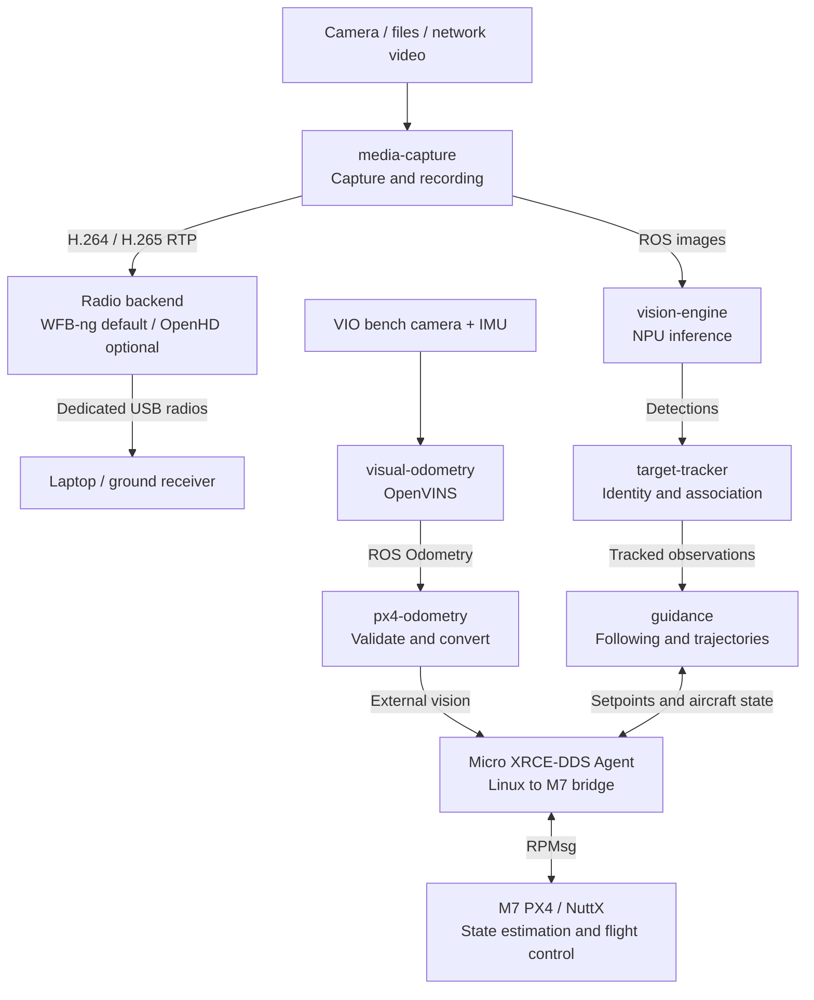

# Raven

A modular drone software platform combining PX4 flight control, ROS 2, video
capture, edge AI and field updates in one Yocto build.

The current platform is NXP FRDM-IMX95: Linux runs on the Cortex-A55 cores and
PX4/NuttX runs on the Cortex-M7. Hardware and inference backends are separated
from application logic to support future platforms.

Start with [raven-manifest](https://github.com/Swamy-BV/raven-manifest/tree/develop)
to fetch the platform sources and set up the Yocto build. This repository
contains the Raven layer, services and board integration.

## Demo

[](https://swamy-bv.github.io/raven-demos/)

[Watch the city demo](https://swamy-bv.github.io/raven-demos/): selected-car
following among 21 vehicles, intersections and roundabouts. i.MX95 NPU vision
and Linux guidance run onboard, with M7 PX4 controlling the AirSim aircraft.

## Project highlights

- **Integrated platform:** Yocto builds Linux, M7 PX4/NuttX firmware and the
  i.MX boot container together. Linux and PX4 have been brought up on FRDM-IMX95.
- **Flight communications:** Separate RPMsg channels carry ROS 2 DDS and routed
  MAVLink. Mission upload, takeoff, waypoint travel, offboard commands, landing
  and disarm have been exercised in simulation.
- **Field updates:** SWUpdate web uploads install A/B Linux images and the shared
  i.MX boot container. Slot switching and automatic reboot have been tested.
- **Camera and media:** `media-capture` provides ROS images, CameraInfo, photos,
  recording and preview controls. IMX477 3840 x 2160 JPEG capture and
  hardware-encoded 1280 x 720 browser video have been tested. ROS applications
  and MAVLink camera commands use the same capture operations. Hardware H.264
  (default) and H.265 are selectable; both reached a laptop over WFB-ng at
  720p/15 fps. Native 1080p capture at 50 fps has also been tested with NXP's
  open Neo IPA; native capture, photos, preview and recording now default to
  1080p, with preview and recording configured for 50 fps. Dedicated USB radio
  drivers are separate from the NXP kernel.
- **Edge vision:** `vision-engine` publishes standard ROS vision outputs.
  YOLOv8s detection and PP-LCNet vehicle appearance embeddings have run on the
  Neutron NPU. CPU work remains for preprocessing, association, ROS and guidance;
  acceleration depends on supported model operators.
- **Visual following:** i.MX95 Linux runs detection, tracking and guidance while
  actual M7 PX4 controls the simulated aircraft in Windows AirSim. Open-road
  six-car lane-shuffle and individual bridge scenarios completed 61-second
  following tests. ByteTrack, vehicle ReID and pose-aligned ground association
  support selected-target tracking and reacquisition.
- **Generative AI experiments:** On-board text generation and image question
  answering have produced responses. VLM experiments required CPU fallback;
  they are not a validated NPU-only pipeline.

## Current progress

Validation snapshot: **24 October 2026**. These are simulation and hardware
bring-up results, not physical flight qualification.

| Area | Validated result | Remaining work |
| --- | --- | --- |
| WFB-ng video | RTL8812AU pair: hardware H.264 at 1080p/50 decoded at 49.98 fps over 32 seconds after SWUpdate and reboot. Board CPU averaged 14.9% of six-core capacity. H.265 passed earlier 720p/15 streaming and onboard recording tests | Qualify longer 1080p/50 runs, H.265/50, image quality, packet delay and loss; measure glass-to-glass latency and range |
| WFB-ng telemetry | WFB-ng carried PX4 and camera heartbeats plus 40/40 information responses with accepted command acknowledgements, including 20 with concurrent H.264 video. Ping replies: 10/10 without video, 9/10 with video | Tune the upstream 100 ms MAVLink aggregation window and packet loss; qualify longer runs and range |
| OpenHD (optional) | IMX477 native 1920 x 1080 measured 30.01 fps using NXP open Neo IPA. Hardware H.264 at 720p/30 decoded at 27.1 fps over a 68-second radio run; board CPU averaged 14.4% of six-core capacity. Concurrent telemetry returned 28/30 information responses and 13/15 pings (4.6 ms median RTT). Photo capture and video start/stop commands passed over radio | Resolve radio delivery gaps and intermittent telemetry loss; qualify image quality, glass-to-glass latency, H.265 and range |
| Open-road following | 61-second six-car runs with lane changes, including dense shuffling and a rear escort | Repeatability across speeds, viewpoints and vehicle appearances |
| Bridge recovery | Five-bridge, six-car test passed: same selected identity recovered after every bridge; **92%** active following across the 61-second moving window | Repeat across speeds and viewpoints; qualify longer occlusions |
| City following | About 140 seconds of moving-target following among 21 vehicles with M7 PX4; target-loss hold, landing and disarm after overshoot | Three-minute test did not pass; improve braking, minimum stand-off and tight-turn speed control |
| Target-loss handling | Hold, landing and disarm exercised in the simulation test harness | Qualify recovery transitions and independent safety supervision |
| GPS-denied navigation | OpenVINS on i.MX95 feeds M7 PX4 through DDS. Two GPS-aiding-disabled tests completed 3 m takeoff, 10-second hover and landing; independent truth measured 3.6 cm maximum horizontal hover error on the recorded repeat | VIO height RMSE was 0.89 m; altitude still uses barometer. Qualify square flights, yaw, repeatability and localization-loss behavior |

The five-bridge run passed the original 90% sustained-following requirement.
Active following includes fresh observations and prediction bounded by age and
uncertainty; visual reacquisition took up to 1.93 seconds. The three-second
target-loss hold remains unchanged. Simulator identity checks are evaluation
references only. General ReID accuracy and multi-run reliability remain open.

## Components

The main onboard path is shown below. Component recipes, code and deployment
files live together under `src/`. Camera controls, preview and simulator links
are shown in the [component view](src/README.md).



Capture, inference, tracking and guidance run on i.MX95 Linux. PX4 owns aircraft
state estimation and flight control on the M7. The diagram shows the current
path. The separate VIO bench path runs upstream OpenVINS with AirSim camera
and IMU inputs. `px4-odometry` validates frame, covariance and timestamp data
before forwarding measurements to M7 EKF2. Horizontal vision fusion has passed
the short GPS-aiding-disabled hover tests; barometer and magnetometer remain
active. Ground truth is used only for evaluation. Obstacle mapping remains open.

## Next milestones

1. **GPS-denied simulation:** qualify OpenVINS initialization, drift and timing
   on i.MX95 across more motion cases. Build on the M7 horizontal-fusion hover
   baseline with square flights, yaw, return and landing. Resolve VIO height
   drift before enabling vision height fusion. Ground truth remains an
   evaluation reference.
2. **Continuous following:** repeat the bounded-prediction and reacquisition
   tests across more speeds, appearances and occlusion lengths.
3. **Obstacle-aware autonomy:** add depth-based local mapping and safe trajectory
   planning, then validate localization loss, sensor delays and fallback behavior.

## Build

```sh
repo init -u https://github.com/Swamy-BV/raven-manifest.git -b develop -m raven.xml
repo sync -c -j8 --no-tags
source ./raven-setup-release.sh -b build
bitbake raven-image-swu
```

This target builds the Linux image, PX4 firmware and boot components required
for the SWUpdate bundle.

## Optional OpenHD backend

WFB-ng remains the default radio package. To select OpenHD instead, set this in
`build/conf/local.conf` before building the image:

```bitbake
VIRTUAL-RUNTIME_raven-radio-link = "packagegroup-raven-openhd"
```

`bitbake packagegroup-raven-openhd` builds the headless backend, SysUtils and
its separate RTL8812AU driver without building an image. Both radio services
are opt-in. Start `openhd@<interface>` only on the dedicated USB radio; configure
media-capture with the additional `/usr/share/openhd/media-capture.yaml` profile
and start streaming through its existing controls. MAVLink uses the existing
router; the M7 DDS connection stays separate.

The IMX477 driver exposes an ISP-aligned native 1920 x 1080 mode alongside
its existing 4K mode. The 1080p/30 bench used
`LIBCAMERA_IPA_MODULE_PATH=/usr/lib/libcamera/ipa` to select NXP's open Neo IPA;
NXP's supplied Uguzzi tuning database only contains a 3840 x 2160 profile.
The FRDM default is native 1080p with the open Neo IPA, including 1080p/50
preview and recording. The 4K sensor mode remains available with the matching
Uguzzi IPA configuration and the previously tested 15 fps video profiles.
Sensor timestamps verified 49.99 fps and a 30/50/default rate-switch sequence.
Hardware ISP processing, G2D scaling and hardware video encoding remain in use.
ROS images and CameraInfo
were verified at 640 x 360/15 fps; calibration is still unavailable.

OpenHD and WFB-ng need matching air/ground software and their own pairing keys.
Do not run them together on the same radio. External encoder bitrate remains
controlled by media-capture; OpenHD adaptive bitrate feedback is not connected.
OpenHD source contains an additional
non-military-use notice; its packages preserve that notice alongside GPLv3.

## Contact

For collaboration and project enquiries, reach out to [Swamy BV on LinkedIn](https://www.linkedin.com/in/swamy-bv/).

## License

Copyright (c) 2026 Swamy BV. Raven-owned code and layer metadata are licensed
under AGPL-3.0-only; see [LICENSE](LICENSE). Third-party software, models and
upstream-derived patches retain their respective licenses and notices.
