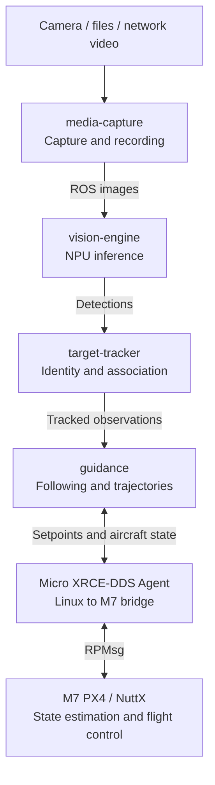

# Raven

A modular drone software platform combining PX4 flight control, ROS 2, video
capture, edge AI and field updates in one Yocto build.

The current platform is NXP FRDM-IMX95: Linux runs on the Cortex-A55 cores and
PX4/NuttX runs on the Cortex-M7. Hardware and inference backends are separated
from application logic to support future platforms.

Start with [raven-manifest](https://github.com/Swamy-BV/raven-manifest/tree/develop)
to fetch the platform sources and set up the Yocto build. This repository
contains the Raven layer, services and board integration.

## Demo

[](https://swamy-bv.github.io/raven-demos/)

[Watch the city demo](https://swamy-bv.github.io/raven-demos/): selected-car
following among 21 vehicles, intersections and roundabouts. i.MX95 NPU vision
and Linux guidance run onboard, with M7 PX4 controlling the AirSim aircraft.

## Project highlights

- **Integrated platform:** Yocto builds Linux, M7 PX4/NuttX firmware and the
  i.MX boot container together. Linux and PX4 have been brought up on FRDM-IMX95.
- **Flight communications:** Separate RPMsg channels carry ROS 2 DDS and routed
  MAVLink. Mission upload, takeoff, waypoint travel, offboard commands, landing
  and disarm have been exercised in simulation.
- **Field updates:** SWUpdate web uploads install A/B Linux images and the shared
  i.MX boot container. Slot switching and automatic reboot have been tested.
- **Camera and media:** `media-capture` provides ROS images, CameraInfo, photos,
  recording and preview controls. IMX477 3840 x 2160 JPEG capture and
  hardware-encoded 1280 x 720 browser video have been tested. ROS applications
  and MAVLink camera commands use the same capture operations.
- **Edge vision:** `vision-engine` publishes standard ROS vision outputs.
  YOLOv8s detection and PP-LCNet vehicle appearance embeddings have run on the
  Neutron NPU. CPU work remains for preprocessing, association, ROS and guidance;
  acceleration depends on supported model operators.
- **Visual following:** i.MX95 Linux runs detection, tracking and guidance while
  actual M7 PX4 controls the simulated aircraft in Windows AirSim. Open-road
  six-car lane-shuffle and individual bridge scenarios completed 61-second
  following tests. ByteTrack, vehicle ReID and pose-aligned ground association
  support selected-target tracking and reacquisition.
- **Generative AI experiments:** On-board text generation and image question
  answering have produced responses. VLM experiments required CPU fallback;
  they are not a validated NPU-only pipeline.

## Current progress

Validation snapshot: **23 October 2026**. These are simulation and hardware
bring-up results, not physical flight qualification.

| Area | Validated result | Remaining work |
| --- | --- | --- |
| Open-road following | 61-second six-car runs with lane changes, including dense shuffling and a rear escort | Repeatability across speeds, viewpoints and vehicle appearances |
| Bridge recovery | Five-bridge, six-car test passed: same selected identity recovered after every bridge; **92%** active following across the 61-second moving window | Repeat across speeds and viewpoints; qualify longer occlusions |
| City following | About 140 seconds of moving-target following among 21 vehicles with M7 PX4; target-loss hold, landing and disarm after overshoot | Three-minute test did not pass; improve braking, minimum stand-off and tight-turn speed control |
| Target-loss handling | Hold, landing and disarm exercised in the simulation test harness | Qualify recovery transitions and independent safety supervision |
| GPS-denied navigation | OpenVINS runs on i.MX95 with AirSim camera + IMU; two 42 m shadow tests measured 0.83 / 1.26 m position RMSE and 0.87 / 1.23 m final drift | Improve initialization/climb error and qualify more motion cases before external-odometry fusion on M7 |

The five-bridge run passed the original 90% sustained-following requirement.
Active following includes fresh observations and prediction bounded by age and
uncertainty; visual reacquisition took up to 1.93 seconds. The three-second
target-loss hold remains unchanged. Simulator identity checks are evaluation
references only. General ReID accuracy and multi-run reliability remain open.

## Components

The main onboard path is shown below. Component recipes, code and deployment
files live together under `src/`. Camera controls, preview and simulator links
are shown in the [component view](src/README.md).



Capture, inference, tracking and guidance run on i.MX95 Linux. PX4 owns aircraft
state estimation and flight control on the M7. The diagram shows the current
path. The separate `visual-odometry` evaluation service runs the upstream
OpenVINS ROS 2 node with AirSim camera and IMU inputs. It publishes standard
ROS odometry for comparison against independent ground truth. PX4 fusion and
obstacle mapping are not yet implemented.

## Next milestones

1. **GPS-denied simulation:** qualify OpenVINS initialization, drift and timing
   on i.MX95 across more motion cases. The current tests use AirSim's internal
   pilot; VIO has no flight-control authority. Then validate
   external-odometry fusion on M7 PX4 with GPS aiding disabled: hover, square
   flight, return and landing. Ground truth remains an evaluation reference.
2. **Continuous following:** repeat the bounded-prediction and reacquisition
   tests across more speeds, appearances and occlusion lengths.
3. **Obstacle-aware autonomy:** add depth-based local mapping and safe trajectory
   planning, then validate localization loss, sensor delays and fallback behavior.

## Build

```sh
repo init -u https://github.com/Swamy-BV/raven-manifest.git -b develop -m raven.xml
repo sync -c -j8 --no-tags
source ./raven-setup-release.sh -b build
bitbake raven-image-swu
```

This target builds the Linux image, PX4 firmware and boot components required
for the SWUpdate bundle.

## Contact

For collaboration and project enquiries, reach out to [Swamy BV on LinkedIn](https://www.linkedin.com/in/swamy-bv/).

## License

Copyright (c) 2026 Swamy BV. Raven-owned code and layer metadata are licensed
under AGPL-3.0-only; see [LICENSE](LICENSE). Third-party software, models and
upstream-derived patches retain their respective licenses and notices.
