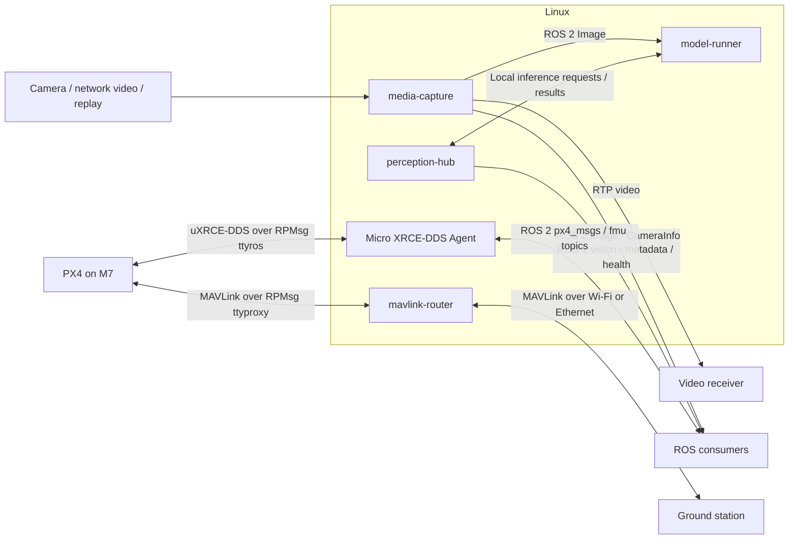

# Raven

A modular drone software platform combining PX4 flight control, ROS 2, video
capture, edge AI and field updates. Raven brings these components into one
Yocto build, providing a foundation for teams developing custom drone products.

The current hardware platform is NXP FRDM-IMX95, with Linux on the A55 cores and
PX4/NuttX on the M7. Hardware and inference backends sit behind component
boundaries to support future platform integration.

## Project highlights

Hardware bring-up, camera capture and simulated flight have been demonstrated
on FRDM-IMX95. PX4's Simulation-In-Hardware (SIH) runs on the M7 alongside Linux;
physical flight with real sensors and actuators remains to be validated.

- **Linux + PX4:** Yocto builds the A55 Linux image, M7 PX4/NuttX firmware and
  i.MX boot container together; both cores have been brought up on the board.
- **Flight communications and simulation:** Independent RPMsg channels carry
  ROS 2 DDS for onboard applications and routed MAVLink for ground stations.
  Python commands from a laptop completed a six-item MAVLink mission, including
  takeoff, waypoint travel, landing and automatic disarm. A separate ROS DDS
  offboard flight exercised translation, climb, yaw and return setpoints before
  landing. ROS telemetry and command acknowledgements were observed throughout.
- **Updates without reflashing:** SWUpdate provides web uploads, A/B Linux
  updates and verified writes of the shared i.MX boot container. Slot switching
  and automatic reboot have been tested on hardware.
- **Media capture:** A GStreamer-based ROS 2 node supports camera, network video
  and replay inputs, with image publication, photos, recording and RTP streaming.
  Arducam IMX477 capture through NXP's camera/ISP stack has been demonstrated at
  640 x 360, 15 fps, with matching ROS Image/CameraInfo messages and JPEG photos.
  Runtime recording controls and ground-station camera commands are next.
- **Model execution:** `model-runner` supports model selection and isolated
  TensorFlow Lite / ONNX inference. Neutron NPU object detection has been exercised;
  acceleration depends on the model and supported operators.
- **ROS perception interfaces:** `perception-hub` translates inference results
  into standard ROS vision messages, with model metadata and pipeline health.
- **Generative AI exploration:** On-board text generation and image question/
  answer experiments have produced responses. These remain experiments; VLM
  execution has required CPU fallback and is not a validated NPU-only pipeline.

Latest bench deployment (16 October 2026): SIH was installed through a boot-only
SWUpdate bundle, and mavlink-router was installed separately. The full SWUpdate
bundle containing all current changes has not yet been rebuilt and deployed.

## Components

Component recipes, code and deployment files live together under `src/`.



## Build

```sh
repo init -u https://github.com/Swamy-BV/raven-manifest.git -b develop -m raven.xml
repo sync -c -j8 --no-tags
source ./raven-setup-release.sh -b build
bitbake raven-image-swu
```

This target builds the Linux image, PX4 firmware and boot components required
for the SWUpdate bundle.

## License

Copyright (c) 2026 Swamy BV. Raven-owned code and layer metadata are licensed
under AGPL-3.0-only; see [LICENSE](LICENSE). Third-party software, models and
upstream-derived patches retain their respective licenses and notices.
