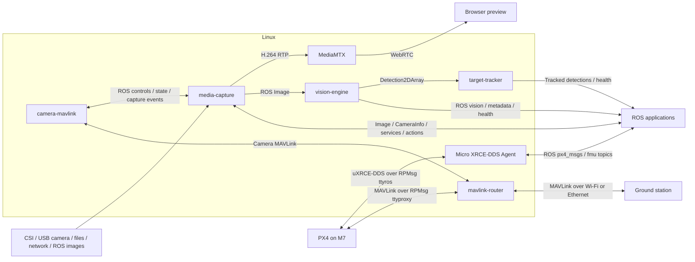

# Raven

A modular drone software platform combining PX4 flight control, ROS 2, video
capture, edge AI and field updates. Raven brings these components into one
Yocto build, providing a foundation for teams developing custom drone products.

The current hardware platform is NXP FRDM-IMX95, with Linux on the A55 cores and
PX4/NuttX on the M7. Hardware and inference backends sit behind component
boundaries to support future platform integration.

## Project highlights

Hardware bring-up, camera capture and simulated flight have been demonstrated
on FRDM-IMX95. PX4's Simulation-In-Hardware (SIH) runs on the M7 alongside Linux;
physical flight with real sensors and actuators remains to be validated.

- **Linux + PX4:** Yocto builds the A55 Linux image, M7 PX4/NuttX firmware and
  i.MX boot container together; both cores have been brought up on the board.
- **Flight communications and simulation:** Independent RPMsg channels carry
  ROS 2 DDS for onboard applications and routed MAVLink for ground stations.
  Python commands from a laptop completed a six-item MAVLink mission, including
  takeoff, waypoint travel, landing and automatic disarm. A separate ROS DDS
  offboard flight exercised translation, climb, yaw and return setpoints before
  landing. ROS telemetry and command acknowledgements were observed throughout.
- **Updates without reflashing:** SWUpdate provides web uploads, A/B Linux
  updates and raw writes of the shared i.MX boot container. Slot switching
  and automatic reboot have been tested on hardware.
- **Media capture:** The ROS 2 camera node separates source adapters, capture
  sessions, photos, recording and preview. IMX477 3840 x 2160 JPEG capture and
  hardware-encoded 1280 x 720 browser video have been tested. ROS images and
  CameraInfo share frame timestamps. Photo sequences, recording controls and
  camera commands from a laptop and PX4 M7 use the same ROS operations.
- **Vision inference:** `vision-engine` combines model selection, isolated
  TensorFlow Lite / ONNX inference and standard ROS vision outputs. Neutron NPU
  object detection has been exercised; acceleration depends on supported operators.
  Capture, recording and flight control remain separate components.
- **Generative AI exploration:** On-board text generation and image question/
  answer experiments have produced responses. These remain experiments; VLM
  execution has required CPU fallback and is not a validated NPU-only pipeline.

## Components

Component recipes, code and deployment files live together under `src/`.



## Build

```sh
repo init -u https://github.com/Swamy-BV/raven-manifest.git -b develop -m raven.xml
repo sync -c -j8 --no-tags
source ./raven-setup-release.sh -b build
bitbake raven-image-swu
```

This target builds the Linux image, PX4 firmware and boot components required
for the SWUpdate bundle.

## License

Copyright (c) 2026 Swamy BV. Raven-owned code and layer metadata are licensed
under AGPL-3.0-only; see [LICENSE](LICENSE). Third-party software, models and
upstream-derived patches retain their respective licenses and notices.
