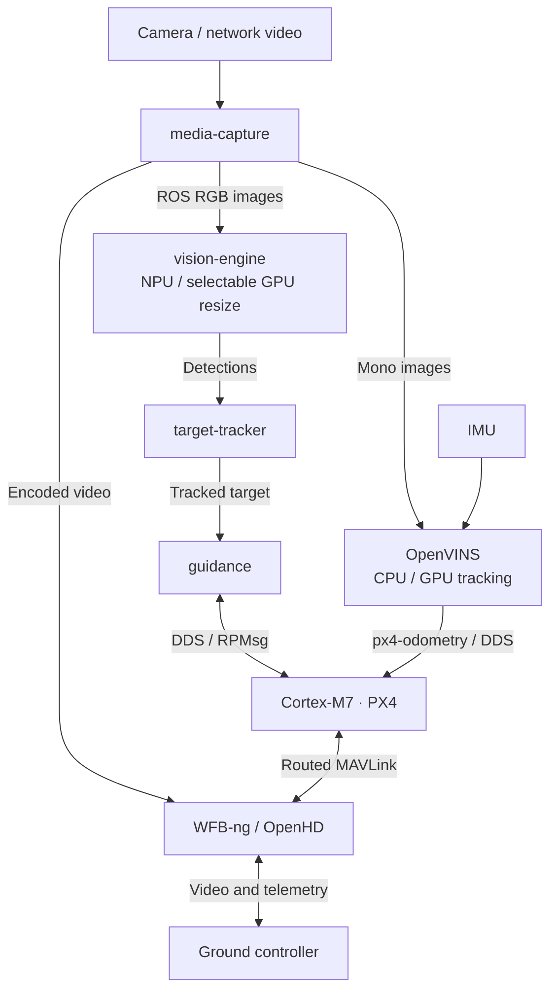

# Raven

A modular drone platform on **NXP FRDM-IMX95**: Cortex-M7 PX4 flight control,
Cortex-A55 Linux, ROS 2 and onboard AI, integrated with Yocto.

## Demo

[](https://swamy-bv.github.io/raven-demos/)

[Watch the city demo](https://swamy-bv.github.io/raven-demos/): selected-car
following among 21 vehicles, intersections and roundabouts. i.MX95 runs vision
and guidance; its M7 runs PX4 controlling the AirSim aircraft.

## Features

- **One firmware build:** Linux, M7 PX4 and i.MX boot firmware.
- **Flight connectivity:** ROS 2 DDS over RPMsg and routed MAVLink telemetry,
  missions and commands.
- **Camera:** ROS images and calibration, photos, recording and browser preview;
  ROS/MAVLink controls, hardware ISP, G2D conversion and H.264/H.265 encoding.
  Native 1080p/50 capture and 4K photos tested.
- **Wireless links:** WFB-ng and OpenHD video backends with bidirectional MAVLink.
- **Vision and following:** Neutron NPU detection and vehicle ReID, ByteTrack
  tracking, selected-target guidance and standard ROS vision messages.
  Selectable Mali-G310 OpenCL image resizing reduces CPU preprocessing.
- **Visual navigation:** OpenVINS camera/IMU odometry, selectable GPU feature
  tracking and an odometry adapter to M7 PX4 over DDS.
- **Updates:** SWUpdate web uploads, A/B Linux slots, boot firmware updates and
  automatic slot switching and reboot.

## Current state

- **M7 HITL:** City following, bridge reacquisition, and GPS-aiding-disabled
  hover and landing tested; barometer aiding remains active.
- **GPU bench tests:** Live-camera resizing reduced vision-engine CPU from
  approximately 35% to 17% of one A55 core in 20-second samples. OpenVINS GPU
  tracking was evaluated on i.MX95 against AirSim ground truth.
- **AI demos:** Onboard text generation and image question answering demonstrated;
  image question answering required CPU fallback.

GPU paths remain opt-in; M7 HITL validation is pending. Resize backends produce
different detection boxes and scores; accuracy qualification is pending.
Physical flight and obstacle avoidance are not yet validated.

## Components



Linux hosts capture, vision, tracking, guidance and visual odometry.
[Component details](src/README.md).

## Build

Fetch with [raven-manifest](https://github.com/Swamy-BV/raven-manifest/tree/develop):

```sh
repo init -u https://github.com/Swamy-BV/raven-manifest.git -b develop -m raven.xml
repo sync -c -j8 --no-tags
source ./raven-setup-release.sh -b build
bitbake raven-image-swu
```

## Contact

[Swamy BV on LinkedIn](https://www.linkedin.com/in/swamy-bv/)

## License

Raven-owned code and layer metadata: [AGPL-3.0-only](LICENSE).
Third-party software, models and patches retain their respective licenses,
including OpenHD's additional non-military-use notice.
