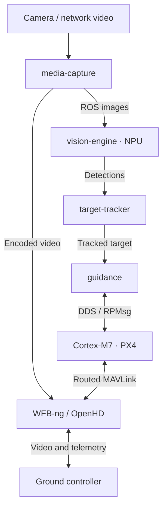

# Raven

A modular drone platform on **NXP FRDM-IMX95**, combining Cortex-M7 PX4 flight
control with Cortex-A55 Linux, ROS 2 and onboard AI in one Yocto build.

## Demo

[](https://swamy-bv.github.io/raven-demos/)

[Watch the city demo](https://swamy-bv.github.io/raven-demos/): selected-car
following among 21 vehicles, intersections and roundabouts. i.MX95 NPU vision
and Linux guidance run onboard, with M7 PX4 controlling the AirSim aircraft.

## Features

- **Integrated firmware:** Linux, M7 PX4 and the i.MX boot container built together.
- **Flight connectivity:** ROS 2 DDS over RPMsg and routed MAVLink for telemetry,
  missions and flight commands.
- **Camera and media:** ROS images and CameraInfo, photo capture, recording and
  browser preview, with ROS and MAVLink controls. Hardware ISP and H.264/H.265
  encoding; native 1080p/50 capture and 4K photos tested.
- **Wireless video and telemetry:** WFB-ng and OpenHD backends, with bidirectional
  MAVLink. WFB-ng H.264 video received at 1080p/50; OpenHD video and camera
  commands tested alongside telemetry.
- **Onboard vision:** Neutron NPU-backed detection and vehicle ReID, ByteTrack
  tracking and selected-target following, with standard ROS vision messages.
- **Visual navigation:** OpenVINS visual-inertial odometry feeds M7 PX4 through
  ROS 2 DDS.
- **Field updates:** SWUpdate web uploads, A/B Linux images and boot firmware
  updates, with automatic slot switching and reboot.

## Progress

- **Following:** M7 PX4 hardware-in-the-loop runs cover city traffic, lane
  changes and bridge occlusions. The five-bridge run recovered the selected
  vehicle after every bridge, with 92% active following over 61 seconds.
- **GPS-denied hover:** Takeoff, hover and landing tested with horizontal visual
  odometry aiding and GPS aiding disabled; altitude still uses the barometer.
- **Generative AI:** Onboard text generation and image question answering
  demonstrated; image question answering required CPU fallback.

Flight behavior has been evaluated in simulation with the physical M7 running
PX4. Physical flight and obstacle avoidance are not yet validated.

## Components



Capture, vision, tracking and guidance run on i.MX95 Linux.
[Component details](src/README.md).

## Build

Fetch the platform with [raven-manifest](https://github.com/Swamy-BV/raven-manifest/tree/develop):

```sh
repo init -u https://github.com/Swamy-BV/raven-manifest.git -b develop -m raven.xml
repo sync -c -j8 --no-tags
source ./raven-setup-release.sh -b build
bitbake raven-image-swu
```

## Contact

[Swamy BV on LinkedIn](https://www.linkedin.com/in/swamy-bv/)

## License

Raven-owned code and layer metadata: [AGPL-3.0-only](LICENSE).
Third-party software, models and patches retain their respective licenses,
including OpenHD's additional non-military-use notice.
