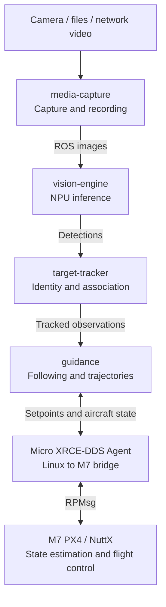
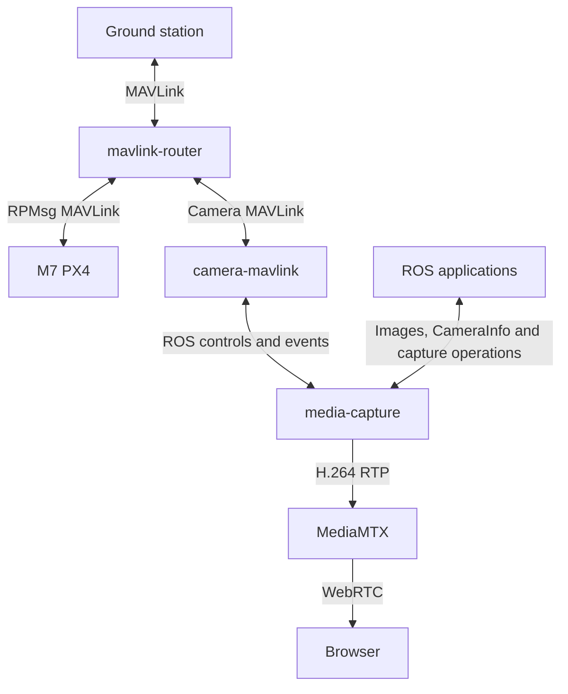
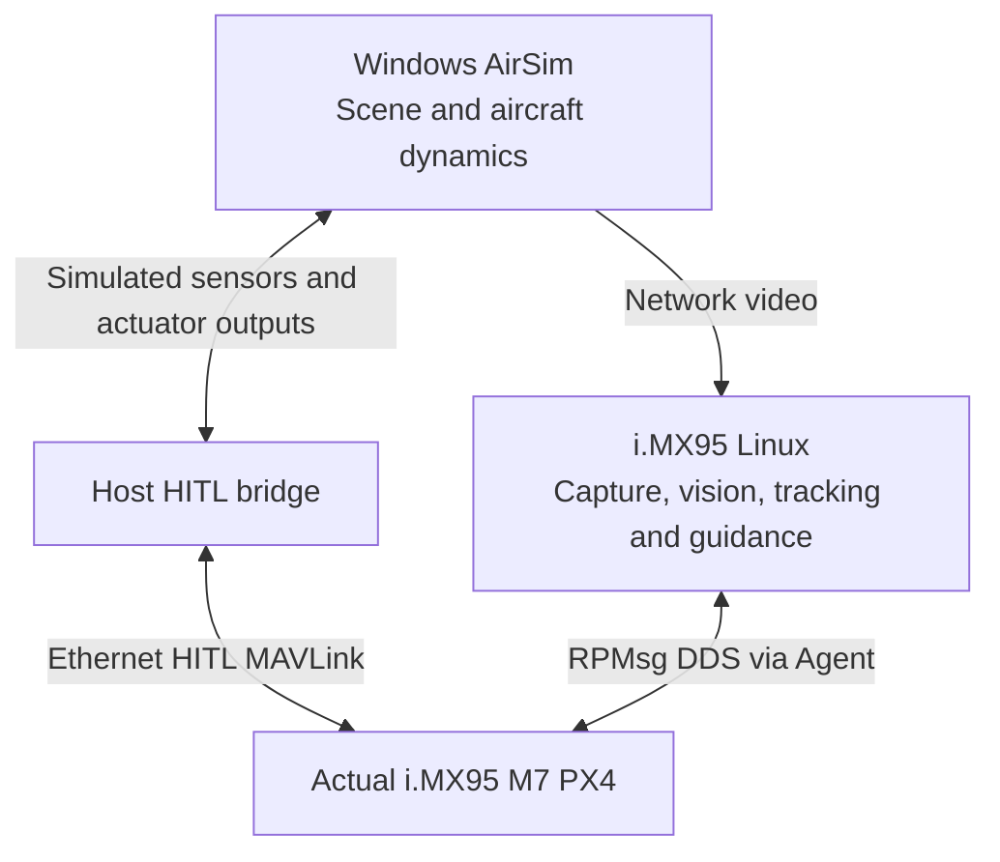
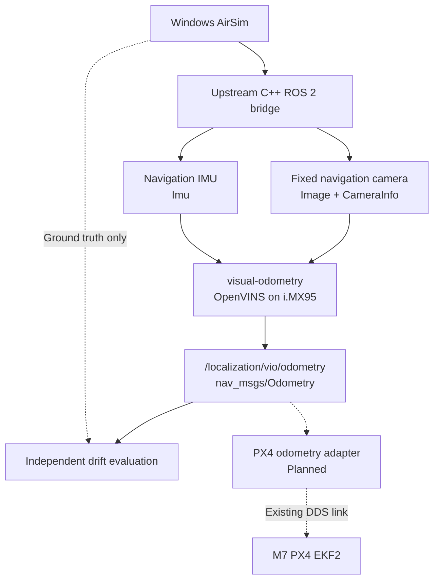

# Components

## Vision and flight

## Camera and external interfaces

## Current hardware-in-the-loop evaluation

## Visual odometry evaluation

OpenVINS runs in shadow mode on i.MX95 Linux. The upstream AirSim C++ ROS 2
bridge supplies the navigation camera and IMU; a separate evaluator receives
ground truth. AirSim's internal pilot flies these tests. PX4 fusion remains
an integration step after initialization, drift and timing are qualified.

