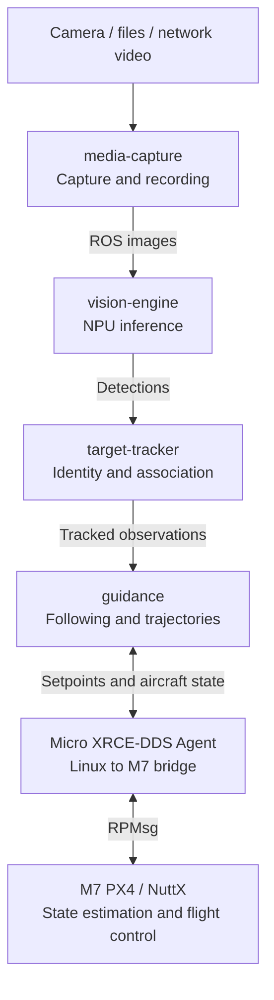
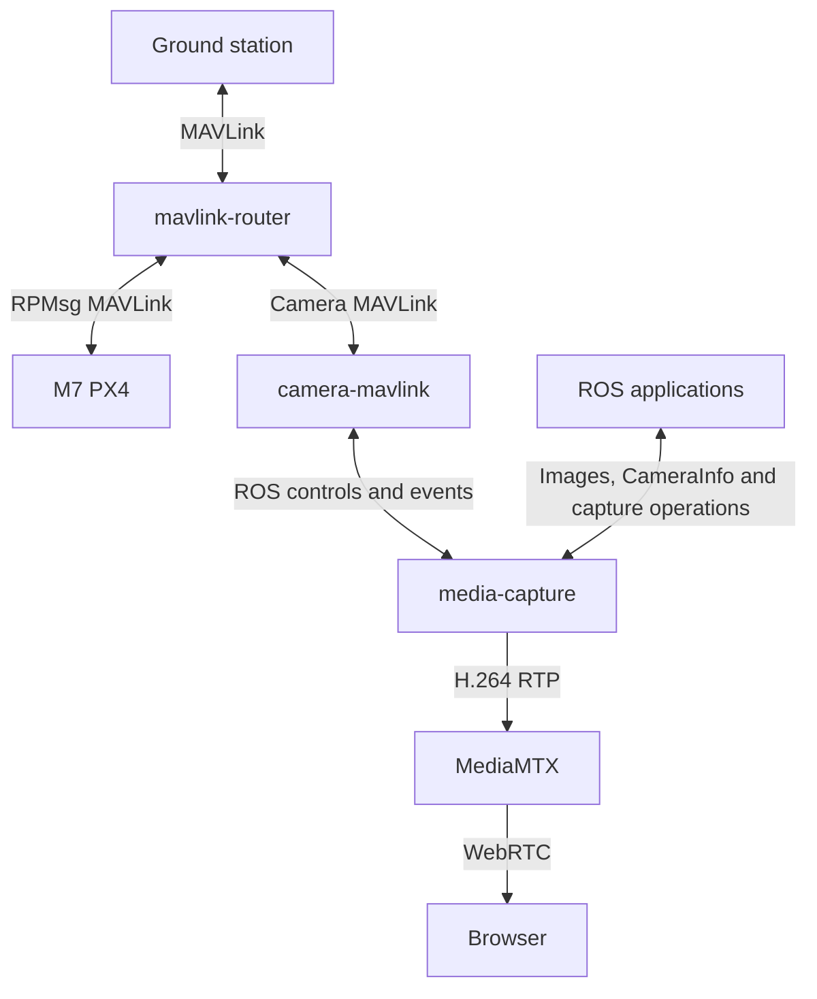
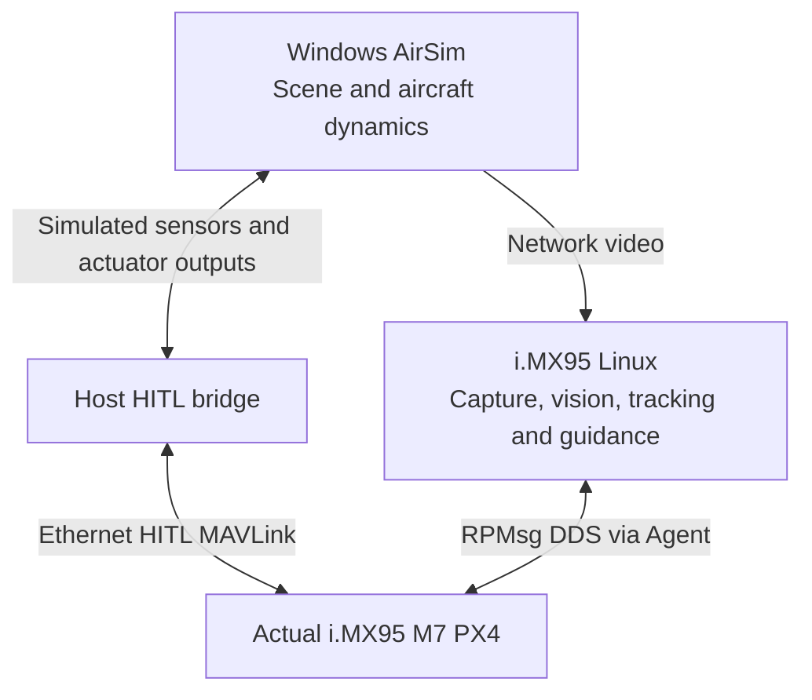
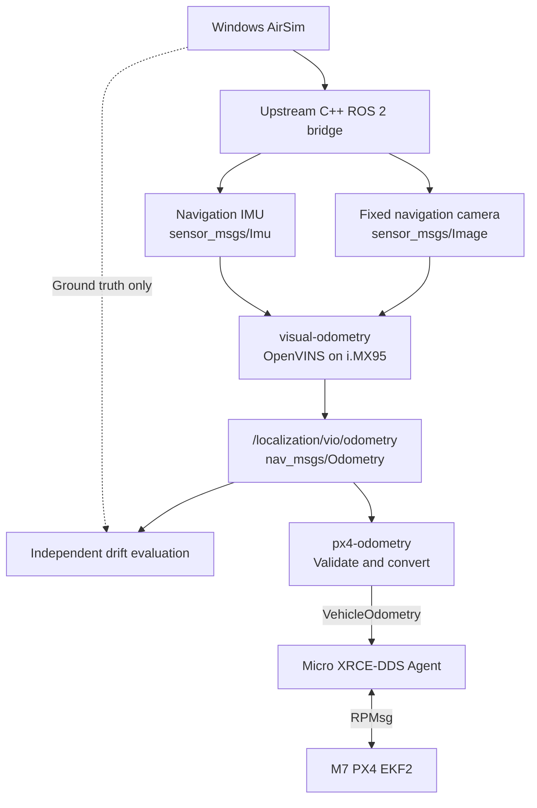

# Components

## Vision and flight

## Camera and external interfaces

## Current hardware-in-the-loop evaluation

## Visual odometry evaluation

`visual-odometry` runs the upstream OpenVINS ROS 2 node on i.MX95 Linux.
`px4-odometry` checks acquisition time, frames and covariance, then converts
the estimate into PX4 FRD measurements over the existing DDS link. The adapter
is disabled by default. GPS-aiding-disabled M7 hover and landing have passed
with horizontal vision fusion; barometer and magnetometer remain active.
VIO height drift and more motion cases still need qualification.

